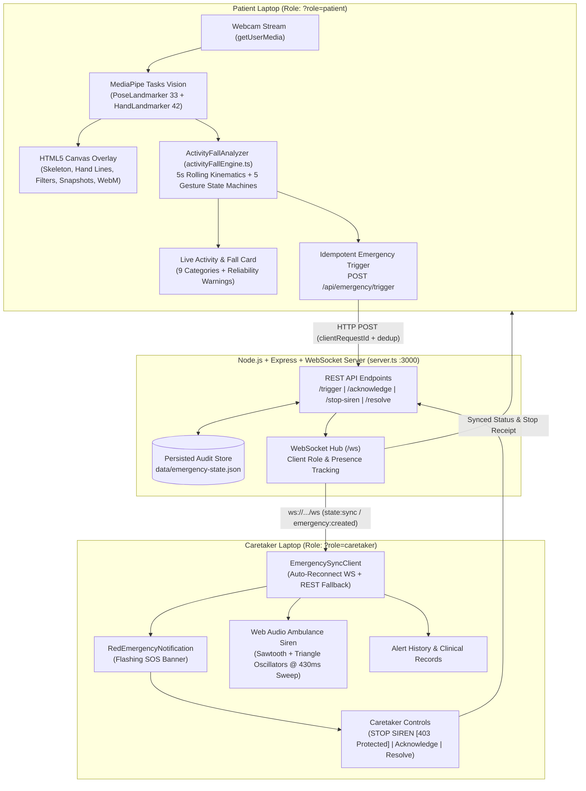
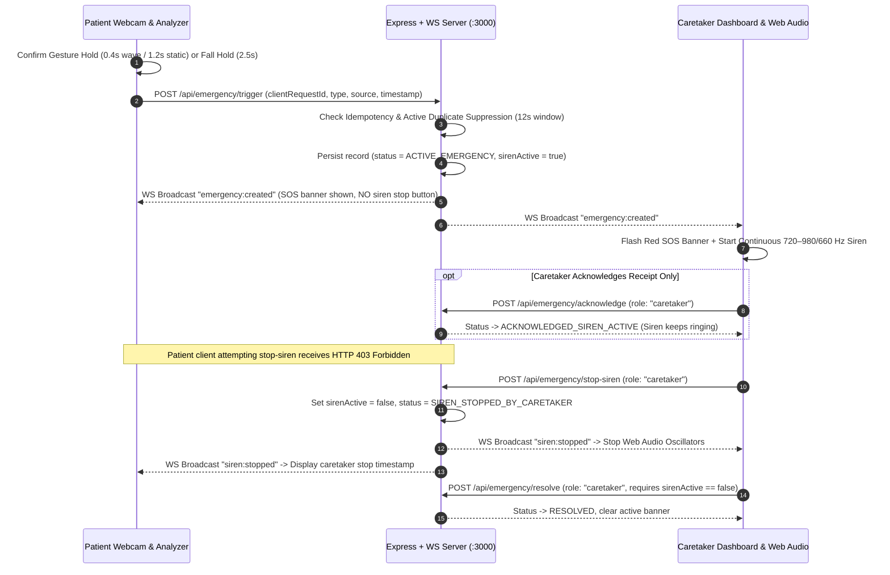
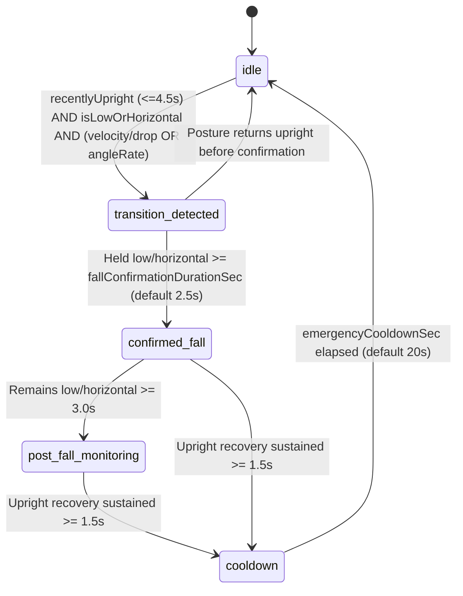

<div align="center">

# 🩺 CARESIGNAL — Smart AI Emergency Monitoring System for Paralysis Patients

<p>
  <strong>Real-Time Browser Computer Vision, Temporal Fall Detection, Emergency Hand Gesture Signaling &amp; Two-Laptop WebSocket Siren Control</strong>
</p>

<p>
  
  
  
  
  
  
</p>

<p>
  <em>Final-Year Computer Science &amp; Engineering (CSE) Capstone Project · Progressive Stage 1 → Stage 3 Clinical Assistive Monitoring System</em>
</p>

<br />


</div>

---

## 📋 Overview

**CARESIGNAL** is a full-stack, browser-native assistive healthcare monitoring and emergency alerting system engineered specifically for **paralysis and motor-impaired patients** in home-care or bedside recovery environments. Using only a standard laptop webcam and modern browser APIs—without requiring Python backends, dedicated wearables, depth cameras, or paid cloud inference APIs—CARESIGNAL executes real-time **MediaPipe Pose Landmarker (33 body landmarks)** and **MediaPipe Hand Landmarker (21 landmarks per hand)** directly on live `getUserMedia` video frames.

Built progressively across **three operational engineering stages**, the system combines live skeletal tracking, a temporal **9-class activity recognition & preliminary fall detection engine**, **five dedicated emergency hand/upper-body distress gestures**, **role-separated two-laptop WebSocket synchronization** (`Patient Monitor` ↔ `Caretaker Console`), **disk-persisted alert audit logs**, and a **caretaker-exclusive continuous Web Audio ambulance siren** that cannot be silenced from the patient device.

---

## 📑 Table of Contents

- [1. Problem Statement & Objectives](#1-problem-statement--objectives)
- [2. Proposed Solution & Stage Progression](#2-proposed-solution--stage-progression)
- [3. Complete Technology Stack](#3-complete-technology-stack)
- [4. System Architecture & Workflow Diagrams](#4-system-architecture--workflow-diagrams)
- [5. Computer Vision & Mathematical Methodology](#5-computer-vision--mathematical-methodology)
- [6. Detailed Implementation Breakdown](#6-detailed-implementation-breakdown)
- [7. Application Modules & Real Screenshots](#7-application-modules--real-screenshots)
- [8. Source Code Highlights & Folder Structure](#8-source-code-highlights--folder-structure)
- [9. Dataset Collection & Model Readiness](#9-dataset-collection--model-readiness)
- [10. Observed Results & Runtime Verification](#10-observed-results--runtime-verification)
- [11. Honest Limitations & Future Scope](#11-honest-limitations--future-scope)
- [12. Installation & Execution Instructions](#12-installation--execution-instructions)

---

## 1. Problem Statement & Objectives

> *"Paralysis and post-stroke patients recovering at home frequently experience asymmetric limb mobility, impaired speech, or difficulty reaching physical call buttons during acute distress. Conventional camera feeds require continuous human attention, while wearable panic pendants fail when uncharged, forgotten, or physically unreachable during a fall or respiratory episode."*

### Core Engineering Objectives

- **Zero-Hardware Contactless Vision:** Run real-time full-body pose (`33` landmarks) and dual-hand tracking (`42` landmarks) on ordinary consumer laptop webcams inside the browser via `WebGL` GPU acceleration with automatic `WASM` CPU fallback.
- **Temporal Activity & Preliminary Fall Analysis:** Distinguish normal seated, upright, walking, resting, and horizontal postures from **sudden upright-to-low/horizontal fall transitions** confirmed across configurable durations and protected by cooldown logic.
- **Accessible Emergency Gesture Vocabulary:** Support **five distinct emergency signals** (ranging from bilateral waving to single-hand and neck-covering distress gestures) tailored for patients who may retain mobility in only one limb or cannot vocalize.
- **Strict Caretaker Siren Authority:** Synchronize emergencies over persistent **WebSockets** between a `Patient Monitor` laptop and a `Caretaker Dashboard` laptop, firing a flashing visual SOS banner and a continuous hi-lo ambulance siren that **only the caretaker can stop** (enforced at both UI and Express API levels with `HTTP 403`).
- **Clinical & ML Data Readiness:** Provide integrated patient clinical profiles, filterable medical history logs, browser voice reassurance notes (`MediaRecorder` + Web Speech API), and structured landmark vector export (`JSON` / `CSV`) to support supervised Stage 4 classifier training.

---

## 2. Proposed Solution & Stage Progression

CARESIGNAL is designed as a modular clinical workbench where every stage adds verifiable real-time capability without breaking prior functionality:

| Stage | Subsystem | Implemented Capabilities | Implementation Status |
| :--- | :--- | :--- | :--- |
| **Stage 1** | **Live Vision & Clinical Workspace** | `getUserMedia` webcam pipeline, MediaPipe Pose (`33` pts) & Hand (`21` pts/hand) overlay, 13-joint telemetry table, brightness/contrast/zoom/mirror/fullscreen/theater/snapshot/WebM recording controls, Patient Profile, Medical History, Voice Messages. | ✅ **Complete & Live** |
| **Stage 2** | **Activity & Preliminary Fall Engine** | Temporal 5s rolling biomechanics window, 9 activity classes (`Standing`, `Walking`, `Sitting`, `Lying down`, `Resting`, `Sleeping-like still posture` estimate, `Fall transition`, `Post-fall posture`, `Unusual movement`), configurable fall confirmation & cooldown, Safe Simulation Mode (`Normal Standing → Controlled Lowering`). | ✅ **Complete & Live** |
| **Stage 3** | **Emergency Gestures, Siren & Dual-Laptop Sync** | 5 MediaPipe Hands + Pose emergency gesture detectors (`Both Hands Waving`, `One Hand Waving`, `One Open Palm & One Closed Fist`, `Hands Covering Neck`, `One Fully Open Raised Hand`), Web Audio continuous hi-lo siren, flashing SOS notification bar, Node/Express REST + `/ws` WebSocket sync, JSON disk persistence. | ✅ **Complete & Live** |
| **Stage 4** | **Custom Temporal ML Training** | Train custom Bi-LSTM / Temporal MLP / Random Forest models on landmark sequences exported from `Dataset Collection` (tracked transparently in `Model Training`). | 🗓️ **Planned Roadmap** |

---

## 3. Complete Technology Stack

| Layer | Technology / Library | Version | Role in CARESIGNAL |
| :--- | :--- | :--- | :--- |
| **Frontend Framework** | React + TypeScript | `19.0.1` / `7.0.2` | Modular SPA architecture, strongly typed clinical & telemetry state management |
| **Build Tooling** | Vite + `@vitejs/plugin-react` | `8.3.0` / `6.1.1` | Fast bundling & middleware integration with Express backend |
| **Styling & Icons** | Tailwind CSS + Lucide React + Motion | `4.3.3` / `0.546.0` / `12.23.24` | White & soft-green clinical dashboard UI, dark-green sidebar, emergency flash keyframes |
| **Computer Vision** | `@mediapipe/tasks-vision` | `1.2.3` | Browser-side `PoseLandmarker` (`lite`/`full`) & `HandLandmarker` (`1`–`2` hands) with locally hosted WASM runtime in `public/mediapipe/wasm/` |
| **Backend & Sync** | Node.js + Express + `ws` | `4.21.2` / `8.23.0` | Role-enforced emergency REST API, WebSocket state broadcast (`/ws`), static & Vite middleware serving |
| **State Persistence** | Filesystem JSON + Browser Storage | Native | `data/emergency-state.json` on server; `localStorage` & `sessionStorage` for profile, settings, and dataset samples |
| **Browser Audio & Media** | Web Audio API, `MediaRecorder`, `getUserMedia`, Web Speech API | Browser Native | Real-time webcam capture, canvas composite WebM video export, dual-oscillator ambulance siren (`980`/`660` Hz), voice notes & spoken phrases |

---

## 4. System Architecture & Workflow Diagrams

### 4.1 End-to-End Two-Laptop & Computer Vision Architecture



### 4.2 Emergency Detection, Siren Lifecycle & Role-Authority Sequence



### 4.3 Preliminary Fall Detection State Machine



---

## 5. Computer Vision & Mathematical Methodology

All vision processing executes inside the client browser using normalized image coordinates $(x, y) \in [0, 1]^2$ produced per video frame by MediaPipe (`PoseLandmarker` indices `0..32` and `HandLandmarker` indices `0..20`).

### 5.1 Torso Inclination Angle & Geometric Posture Features

To remain invariant to camera distance and frame position, torso inclination $\theta_{\text{torso}}$ is computed from the vector connecting the visible hip midpoint $H = (x_H, y_H)$ (indices `23`, `24`) and shoulder midpoint $S = (x_S, y_S)$ (indices `11`, `12`):

$$
L_{\text{torso}} = \max\left(0.05,\; \sqrt{(x_S - x_H)^2 + (y_S - y_H)^2}\right)
$$

$$
\theta_{\text{torso}} = \text{atan2}\left(|x_S - x_H|,\; \max(10^{-4},\; y_H - y_S)\right) \times \frac{180}{\pi}
$$

- **Purpose:** Quantifies verticality regardless of subject height or horizontal camera offset ($\theta_{\text{torso}} \approx 0^\circ$ upright; $\theta_{\text{torso}} \ge 50^\circ$ horizontal).
- **Used in:** `ActivityFallAnalyzer.processFrame()` (`src/utils/activityFallEngine.ts`) to classify `Standing`, `Sitting`, `Lying down`, and `isHorizontal` transitions (combined with bounding-box aspect ratio $W_{\text{bbox}} / H_{\text{bbox}} \ge 1.15$ when $\theta_{\text{torso}} \ge 40^\circ$).

### 5.2 Torso-Normalized Motion Energy & Fall Kinematics

Inter-frame joint displacement across $11$ core landmarks $\mathcal{J} = \{0, 11, 12, 15, 16, 23, 24, 25, 26, 27, 28\}$ is normalized by $L_{\text{torso}}$ and elapsed frame interval $\Delta t$:

$$
E_{\text{motion}}(t) = \min\left(8,\; \frac{1}{|\mathcal{J}_{\text{vis}}| \cdot \Delta t} \sum_{i \in \mathcal{J}_{\text{vis}}} \frac{\sqrt{(x_i(t) - x_i(t-1))^2 + (y_i(t) - y_i(t-1))^2}}{L_{\text{torso}}}\right)
$$

Over a temporal lookback window $\Delta t_w \in [0.3\text{s}, 1.1\text{s}]$ inside the `5.0s` rolling frame buffer, downward drop velocity $v_y$ and torso angular velocity $\omega_{\text{torso}}$ are evaluated as:

$$
v_y = \frac{\max\left(y_{\text{center}}(t) - y_{\text{center}}(t - \Delta t_w),\;\; y_H(t) - y_H(t - \Delta t_w)\right)}{\Delta t_w}, \qquad \omega_{\text{torso}} = \frac{\theta_{\text{torso}}(t) - \theta_{\text{torso}}(t - \Delta t_w)}{\Delta t_w}
$$

- **Purpose:** Prevents false fall alerts during controlled sitting or slow lying down. A fall transition only enters `transition_detected` if the subject was verified upright within the last `4.5s` (`isRecentlyUpright`) **and** exceeds sensitivity-scaled velocity/drop/angular thresholds, then stays low/horizontal for `fallConfirmationDurationSec`.
- **Used in:** `ActivityFallAnalyzer` activity state differentiation (`Sleeping-like still posture` when horizontal + $\bar{E}_{\text{motion}} < 0.045$ for $\ge 10\text{s}$; `Unusual movement` when $\bar{E}_{\text{motion}} \ge 0.42$ without walking gait).

### 5.3 Finger Extension, Waving Reversals & Neck Region Ellipse

Using MediaPipe Hand landmarks (wrist $W = \text{lm}_0$, middle knuckle $M_9 = \text{lm}_9$), palm scale is normalized as $P_{\text{scale}} = \max(0.025, \|W - M_9\|_2)$. Each finger $f \in \{\text{index}, \text{middle}, \text{ring}, \text{pinky}\}$ is classified as extended when:

$$
\|T_f - W\|_2 > 1.12\,\|PIP_f - W\|_2 \;\land\; \|T_f - W\|_2 > 1.25\,\|MCP_f - W\|_2 \;\land\; \|T_f - W\|_2 > 1.22\,P_{\text{scale}}
$$

Thumb extension is evaluated across the palm span via $\|\text{lm}_4 - \text{lm}_{17}\|_2 > 1.13\,\|\text{lm}_2 - \text{lm}_{17}\|_2$ and $\|\text{lm}_4 - \text{lm}_5\|_2 > 0.36\,P_{\text{scale}}$.

For **Hands Covering Neck**, the anatomical neck center $N = (x_N, y_N)$ is dynamically estimated between the shoulder midpoint $S_{\text{mid}}$ and head reference $H_{\text{ref}}$ (nose or ear midpoint), forming an elliptical region of interest scaled to torso geometry:

$$
N = 0.65\,S_{\text{mid}} + 0.35\,H_{\text{ref}} \quad (\text{X}), \qquad N_y = 0.62\,S_{\text{mid},y} + 0.38\,H_{\text{ref},y}
$$

$$
\left(\frac{p_x - x_N}{r_x}\right)^2 + \left(\frac{p_y - y_N}{r_y}\right)^2 \le 1.2, \qquad r_x = \max(0.085, 0.45 \cdot W_{\text{shoulder}}),\;\; r_y = \max(0.075, 0.65 \cdot |S_{\text{mid},y} - H_{\text{ref},y}|)
$$

- **Purpose:** Evaluates hand probe points (`palmCenter`, `lm[5]`, `lm[9]`, `lm[13]`) smoothly even when one shoulder is partially angled away from the camera, while explicitly refusing to guess when head or shoulders are occluded.
- **Used in:** `evaluateEmergencyGestures()` with nearest-neighbor multi-hand motion tracking (`1.8s` sample window, axis swing reversals $\ge 0.032$) and per-gesture hold timers (`0.4s` waving, `1.2s` static gestures with `220ms` jitter tolerance and `650ms` unlatch).

---

## 6. Detailed Implementation Breakdown

### 6.1 Stage 1 — Live Webcam, Dual MediaPipe Inference & Clinical Media Controls
- **Locally Hosted WASM + Dual Model Loading (`src/utils/mediapipe.ts`):** Loads `FilesetResolver` from `/mediapipe/wasm` (`vision_wasm_internal.*`) and initializes `PoseLandmarker` (`pose_landmarker_lite.task` or `pose_landmarker_full.task`) alongside `HandLandmarker` (`hand_landmarker.task`) in `VIDEO` running mode. Automatically falls back from `GPU` (`WebGL`) delegate to `CPU` (`WASM`) if WebGL initialization fails, surfacing explicit diagnostics when offline or missing permissions.
- **Real-Time Canvas Renderer & Viewport Controls (`src/views/PatientMonitoring.tsx`):** Draws mirrored or unmirrored `PoseLandmarker.POSE_CONNECTIONS` and `HandLandmarker.HAND_CONNECTIONS` onto a synchronized overlay `<canvas>` without blocking frame inference. Supports live **brightness/contrast/zoom sliders**, **camera device switcher**, **pause/resume**, **annotated composite PNG snapshots**, **composite WebM recording** via `MediaRecorder`, **fullscreen**, and **theater mode** fallback.
- **13-Joint Coordinate Inspection:** Continuously extracts normalized `(x, y, z)` and visibility scores for Head (`0`), Shoulders (`11, 12`), Elbows (`13, 14`), Wrists (`15, 16`), Hips (`23, 24`), Knees (`25, 26`), and Ankles (`27, 28`).

### 6.2 Stage 2 — 9-Class Activity Classification & Safe Fall Verification
- **Activity Categories:** Classifies `Standing`, `Walking`, `Sitting`, `Lying down`, `Resting`, `Sleeping-like still posture` (explicitly labeled as a `10+` second low-motion horizontal estimate, never a medical sleep claim), `Fall transition`, `Post-fall posture`, `Unusual movement`, plus `Person not detected` and torso occlusion warnings.
- **Live Activity Banner Mapping:** Updates the monitoring status strip across `NORMAL — STANDING`, `NORMAL — WALKING`, `NORMAL — SITTING`, `NORMAL — RESTING`, `POSSIBLE FALL DETECTED`, `POST-FALL MONITORING`, and `PERSON NOT DETECTED`.
- **Safe Simulation Mode:** Provides a non-hazardous webcam verification workflow (`Normal Standing -> Controlled Lowering`) plus simulated kinematics test buttons so reviewers can verify fall confirmation timers (`1.0s`–`8.0s`) and cooldown behavior safely without performing dangerous real falls.

### 6.3 Stage 3 — 5 Emergency Gestures, Continuous Siren & Two-Laptop Sync
- **Supported Emergency Gestures:**
  1. **Both Hands Waving (`0.4s` hold):** Tracks two active wrist trajectories concurrently (`>= 3` directional reversals and `>= 0.16` normalized travel within `1.8s`).
  2. **One Hand Waving (`0.4s` hold):** Detects repeated waving by either left or right hand (`>= 4` reversals, `>= 0.20` travel) even when the opposite hand is out of frame or paralyzed.
  3. **One Open Palm & One Closed Fist (`1.2s` hold):** Requires two visible hands where one exhibits `5/5` extended fingers and the other has all fingers and thumb curled (`>= 4` curled fingers + curled thumb), supporting both left-open/right-fist and right-open/left-fist.
  4. **Hands Covering Neck (`1.2s` hold):** Confirms one or both hands hovering inside the shoulder-to-head elliptical neck zone across consecutive frames.
  5. **One Fully Open Raised Hand (`1.2s` hold):** Confirms a single `5/5` open palm positioned above shoulder height ($y_{\text{palm}} \le y_{\text{shoulderRef}} + 0.035$).
- **Web Audio Ambulance Siren (`src/utils/audio.ts`):** Synthesizes an unmistakable hospital hi-lo siren using paired `sawtooth` (`720→980/660 Hz`) and `triangle` sub-oscillators (`360→490/330 Hz`) routed through a `2400 Hz` low-pass filter sweeping every `430 ms`. Respects browser autoplay rules via explicit **Enable Sound** unlocking and warns visibly if autoplay is blocked when an SOS arrives.
- **Role-Enforced Backend (`server.ts`):** Persists active and historical emergency records to `data/emergency-state.json`, deduplicates repeated triggers by `clientRequestId` or `12s` same-type window, broadcasts instant WebSocket state updates on `/ws`, and rejects `patient` attempts to acknowledge, stop the siren, or resolve with `HTTP 403`.

---

## 7. Application Modules & Real Screenshots

> All screenshots below were captured directly from the live running CARESIGNAL application.

### 7.1 Caretaker Dashboard & Two-Laptop Sync Hub
Displays patient clinical summary, camera monitoring state, quick SOS/siren test controls, and live connected `Caretaker` vs `Patient` WebSocket sessions with shareable LAN role URLs.

<div align="center">
  
</div>

### 7.2 Live Patient Monitoring & Gesture Testing Panel
Provides webcam feed controls (`Start`, `Pause`, `Stop`, `Brightness`, `Contrast`, `Zoom`, `Mirror`, `Snapshot`, `Record WebM`, `Theater/Fullscreen`), live skeleton/hand overlay toggles, 13-joint telemetry, **Stage 2 Activity Recognition & Preliminary Fall Detection**, and real-time **Stage 3 Gesture Hold Diagnostics**.

<div align="center">
  
  <br /><br />
  
</div>

### 7.3 Active SOS Flashing Banner & Synced Alert History
When an emergency gesture or fall is confirmed, the **Red Emergency Notification** flashes immediately across both laptops. Only the **Caretaker** view exposes the **`STOP SIREN`** control; stopping the siren records caretaker identity and timestamps into the synced audit timeline.

<div align="center">
  
  <br /><br />
  
</div>

### 7.4 Dataset Collection, Model Training Roadmap & Gesture/Audio Settings
Includes structured landmark vector inspection (`JSON` / `CSV` export), transparent Stage 4 model training readiness tracking, and real-time sliders for MediaPipe confidence, fall confirmation duration, sensitivity, cooldown, and siren/chime volumes.

<div align="center">
  
  
  <br /><br />
  
</div>

---

## 8. Source Code Highlights & Folder Structure

### 8.1 Repository Directory Tree

```text
CARESIGNAL/
├── server.ts                         # Express HTTP server, REST API, WebSocket (/ws), JSON persistence
├── package.json                      # Dependencies & scripts (dev, build, start, lint)
├── tsconfig.json                     # TypeScript configuration
├── vite.config.ts                    # Vite React & Tailwind CSS v4 configuration
├── index.html                        # SPA entry point
├── data/
│   └── emergency-state.json          # Persisted server-side emergency & siren audit store
├── docs/
│   └── screenshots/                  # Application screenshots rendered in README
├── public/
│   └── mediapipe/wasm/               # Local MediaPipe Vision WASM binaries & JS glue
│       ├── vision_wasm_internal.js
│       ├── vision_wasm_internal.wasm
│       ├── vision_wasm_module_internal.js
│       └── vision_wasm_module_internal.wasm
└── src/
    ├── App.tsx                       # Root application shell, role state, WS sync & siren lifecycle
    ├── main.tsx                      # React DOM entry
    ├── index.css                     # Tailwind CSS v4 theme & emergency flash animations
    ├── types/caresignal.ts           # Complete TypeScript contracts across Stages 1–3
    ├── data/initialState.ts          # Initial patient profile, clinical logs & default thresholds
    ├── assets/images/                # Patient & caretaker profile avatars
    ├── components/
    │   ├── Sidebar.tsx               # Dark-green clinical navigation rail (9 modules)
    │   ├── TopBar.tsx                # Role switcher (Caretaker/Patient), WS sync pill & audio unlock
    │   └── RedEmergencyNotification.tsx  # Shared SOS banner & Caretaker STOP SIREN controls
    ├── utils/
    │   ├── mediapipe.ts              # FilesetResolver, Pose/Hand Landmarkers & canvas drawing
    │   ├── activityFallEngine.ts     # 9-class activity engine, fall state machine & 5 gesture detectors
    │   ├── audio.ts                  # Web Audio API continuous ambulance siren & clinical chimes
    │   └── emergencyClient.ts        # WebSocket auto-reconnect client & REST API helpers
    └── views/
        ├── CaretakerDashboard.tsx    # Caretaker command overview, siren control & two-laptop URLs
        ├── PatientMonitoring.tsx     # Live webcam, MediaPipe loop, Safe Sim & gesture diagnostics
        ├── PatientProfile.tsx        # Editable paralysis profile & camera placement metadata
        ├── MedicalHistory.tsx        # Filterable & searchable clinical observation records
        ├── DatasetCollection.tsx     # Pose/Hand coordinate sample table, JSON/CSV export & splits
        ├── ModelTraining.tsx         # Transparent Stage 4 training readiness & config blueprint
        ├── AlertHistory.tsx          # Server-synced emergency/siren timeline + local runtime log
        ├── VoiceMessages.tsx         # Microphone audio clip recorder & Web Speech API phrases
        └── GestureAudioSettings.tsx  # Live threshold, MediaPipe & siren volume configuration
```

### 8.2 Key Code Excerpts

#### Server-Side Role Guard for Stopping the Siren (`server.ts`)

```typescript
app.post('/api/emergency/stop-siren', (req, res) => {
  const body = req.body as Record<string, unknown>;
  if (body.role !== 'caretaker') {
    res.status(403).json({
      error: 'Forbidden: Only the caretaker dashboard can stop the emergency siren.',
    });
    return;
  }

  const emergencyId = sanitizeString(body.emergencyId, 80) || store.activeEmergencyId;
  const caretakerIdentity =
    sanitizeString(body.caretakerIdentity, 100) || 'Caretaker Session';
  const nowIso = new Date().toISOString();

  store.sirenActive = false;
  for (const rec of store.history) {
    if (rec.id === emergencyId || rec.sirenActive) {
      rec.sirenActive = false;
      rec.sirenStopTime = rec.sirenStopTime ?? nowIso;
      rec.sirenStoppedBy = rec.sirenStoppedBy ?? caretakerIdentity;
      if (rec.status !== 'RESOLVED') {
        rec.status = 'SIREN_STOPPED_BY_CARETAKER';
      }
    }
  }

  savePersistedStore();
  broadcastState('siren:stopped');
  res.json({ record: updatedTarget, state: getPublicState() });
});
```

#### Finger Extension & Palm Analysis (`src/utils/activityFallEngine.ts`)

```typescript
const palmScale = Math.max(0.025, dist2D(lm[0], lm[9]));
for (let f = 0; f < 4; f++) {
  const tipDist = dist2D(lm[fingerTips[f]], wrist);
  const pipDist = dist2D(lm[fingerPips[f]], wrist);
  const mcpDist = dist2D(lm[fingerMcps[f]], wrist);

  if (tipDist > pipDist * 1.12 && tipDist > mcpDist * 1.25 && tipDist > palmScale * 1.22) {
    extendedFour += 1;
  } else if (
    tipDist < pipDist * 1.07 &&
    dist2D(lm[fingerTips[f]], lm[fingerMcps[f]]) < palmScale * 0.92
  ) {
    curledFour += 1;
  }
}
```

---

## 9. Dataset Collection & Model Readiness

Unlike static dashboards that fabricate training scores, CARESIGNAL separates **live inference** (powered today by MediaPipe pre-trained landmarkers + deterministic temporal biomechanics) from **custom classifier training**:

- **Capture Pipeline (`DatasetCollection.tsx`):** From `Patient Monitoring`, operators select a posture label (`Seated Upright`, `Left Arm Raised`, `Right Hand Signal`, `Lateral Torso Lean`, `Resting Supine`) and capture genuine `33`-point Pose and up to `42`-point Hand normalized coordinate vectors (`x, y, z, visibility`) into browser storage.
- **Train / Validation Splitting & Export:** Each recorded sample supports `unassigned`, `train`, and `validation` split assignment, interactive raw JSON inspection (`nose`, `leftShoulder`, `rightShoulder`, `leftWrist`, `rightWrist`, `leftHip`, `rightHip`), and one-click **`Export JSON`** / **`Export CSV`** downloads.
- **Honest Training Status (`ModelTraining.tsx`):** Displays an explicit notice confirming that custom fall/gesture neural classifier training (`Lightweight Temporal MLP / Bi-LSTM`, `Random Forest / GBT`, or `1D-CNN`) is a **planned Stage 4 deliverable** once sufficient patient-specific samples are collected—no synthetic accuracy, precision, or F1 metrics are reported.

---

## 10. Observed Results & Runtime Verification

The following system behaviors have been directly built and verified against the running CARESIGNAL application (`npm run lint`, `npm run build`, REST/WebSocket API tests, and browser UI verification):

| Verification Area | Verification Method | Observed Outcome |
| :--- | :--- | :--- |
| **TypeScript & Vite Production Build** | `tsc --noEmit` & `vite build` | Zero TypeScript errors; production bundle compiles cleanly alongside `server.ts`. |
| **MediaPipe WASM & Model Initialization** | Local `/mediapipe/wasm` assets + `createVisionLandmarkers()` | WASM files served locally from `public/mediapipe/wasm/` with automatic `GPU -> CPU` delegate fallback and descriptive network/permission error surfacing. |
| **Temporal Fall & Gesture Engine** | Unit & live frame state machine (`ActivityFallAnalyzer`) | Enforces `recentlyUpright` gating (`4.5s`), configurable hold confirmation (`2.5s` default), cooldown (`20s` default), `0.4s` waving confirmation, and `1.2s` static gesture hold with `220ms` jitter tolerance. |
| **Role-Based Siren Authority** | `POST /api/emergency/stop-siren` | Caretaker requests (`role: 'caretaker'`) stop siren and update `data/emergency-state.json`; Patient requests (`role: 'patient'`) are blocked by UI omission and rejected server-side with `HTTP 403`. |
| **Resolve Guardrail** | `POST /api/emergency/resolve` | Returns `HTTP 409` if `sirenActive` is still `true`, ensuring caretaker cannot mark an emergency resolved before stopping the alarm. |
| **Two-Laptop WebSocket Sync** | `/ws` + `EmergencySyncClient` | Active emergencies, acknowledgements, siren stops, and client counts (`C:<n> P:<n>`) synchronize in real time across separate browser sessions and survive page refreshes via `data/emergency-state.json`. |

---

## 11. Honest Limitations & Future Scope

### Current Scope & Engineering Limitations
1. **Heuristic Activity & Fall Rules (No Custom Trained Weights Yet):** Current activity labels (`Standing`, `Walking`, `Sitting`, `Resting`, `Sleeping-like still posture`, `Fall transition`, `Post-fall posture`, `Unusual movement`) and emergency gesture rules rely on deterministic geometric and temporal heuristics atop MediaPipe landmarks rather than a custom patient-trained Stage 4 neural network.
2. **Camera Lighting, Framing & Occlusion Sensitivity:** Heavy backlighting, extreme side angles, blankets obscuring knees/hips, or low webcam frame rates can lower landmark visibility below `activityConfidenceThreshold` (default `0.45`), triggering a reliability warning rather than confident posture classification.
3. **Browser Autoplay & Network Model Fetch:** While MediaPipe WASM binaries are bundled locally in `public/mediapipe/wasm/`, the `.task` model files (`pose_landmarker_*.task`, `hand_landmarker.task`) fetch from `storage.googleapis.com` on first load, and browsers require one interactive **`Enable Sound`** click on the caretaker laptop before `AudioContext` can play sirens automatically.
4. **Local Profile Storage & Non-Diagnostic Scope:** Patient profile, medical history, and dataset samples are persisted in browser `localStorage` (while emergency events & siren logs persist on the Node.js server in `data/emergency-state.json`). `Sleeping-like still posture` is an estimate based on stillness and torso angle—not clinical sleep or medical diagnosis.

### Future Scope (Stage 4 & Clinical Extensions)
- **Supervised Temporal Sequence Training:** Train and evaluate lightweight `Bi-LSTM`, `1D-CNN`, or `Temporal MLP` classifiers in ONNX / TensorFlow.js using labeled multi-frame windows exported from `Dataset Collection`.
- **Database Migration & Multi-Patient Wards:** Replace `data/emergency-state.json` and `localStorage` with a relational or document database supporting multiple patient beds, role authentication, and encrypted audit trails.
- **External Escalation Channels:** Add optional SMS, push notification, or nurse-station webhook integrations alongside the local caretaker siren when an alert remains unacknowledged past a configurable timeout.
- **Offline `.task` Model Bundling:** Mirror MediaPipe `.task` assets under `public/mediapipe/models/` for air-gapped home/clinic LAN deployments.

---

## 12. Installation & Execution Instructions

### Prerequisites
- **Node.js** `v20+` (with `npm`)
- A modern Chromium, Edge, or Firefox browser with **webcam** (for the Patient laptop) and **speakers** (for the Caretaker laptop)
- Internet access on initial run to download MediaPipe `.task` model weights from Google Cloud Storage

### 1. Install Dependencies & Run Development Server

```bash
# 1. Clone the repository and enter the project directory
git clone <your-repository-url>
cd caresignal

# 2. Install Node dependencies
npm install

# 3. Verify TypeScript types (optional)
npm run lint

# 4. Start the full-stack Express + WebSocket + Vite server on port 3000
npm run dev
```

Or build and run in production mode:

```bash
npm run build
npm start
```

The server listens on **`http://0.0.0.0:3000`** (`http://localhost:3000`).

### 2. Single-Laptop Testing Guide

1. Open **`http://localhost:3000`** in your browser (`Caretaker` role by default) and click **`Enable Sound`** in the top navigation bar to unlock browser Web Audio playback.
2. Navigate to **Patient Monitoring** in the left sidebar and click **`Start Monitoring`** (grant webcam permission when prompted).
3. Step into camera view so MediaPipe renders the **33-point green Pose skeleton** and **21-point Hand landmarks** over your live video feed.
4. Test **Stage 2 Activity & Safe Fall Detection**:
   - Stand upright, sit in a chair, or toggle **`Safe Simulation Mode`** (`Normal Standing -> Controlled Lowering`) to observe the `Fall transition` countdown and confirmed fall alert.
5. Test **Stage 3 Emergency Gestures**:
   - Perform any of the 5 supported gestures (**Both Hands Waving**, **One Hand Waving**, **One Open Palm + One Closed Fist**, **Hands Covering Neck**, or **One Fully Open Raised Hand**) while monitoring the live progress bars in the gesture panel.
6. Confirm that the flashing **Red Emergency Banner** activates and the continuous ambulance siren plays until you click **`STOP SIREN`**, then inspect **`Alert History`** for the full timestamped audit record.

### 3. Two-Laptop LAN Testing Guide (Patient Monitor ↔ Caretaker Station)

1. Connect both laptops to the **same Wi-Fi / LAN** and start the server on Laptop A (`npm run dev`). Find Laptop A's local IPv4 address (displayed inside the Caretaker Dashboard's **Two-Laptop Real-Time Sync** panel, or via `hostname -I` / `ipconfig`).
2. **Caretaker Laptop (Laptop A):** Open `http://localhost:3000/?role=caretaker` and click **`Enable Sound`**.
3. **Patient Laptop (Laptop B):** Open `http://<LAPTOP_A_IP>:3000/?role=patient` (note: non-localhost `getUserMedia` webcam access may require HTTPS or adding the LAN origin to `chrome://flags/#unsafely-treat-insecure-origin-as-secure` in Chromium for local LAN testing).
4. Start the webcam on Laptop B, perform a distress gesture or trigger a simulated fall, and verify that Laptop A immediately flashes the SOS alert and sounds the continuous ambulance siren until the caretaker clicks **`STOP SIREN`**.
